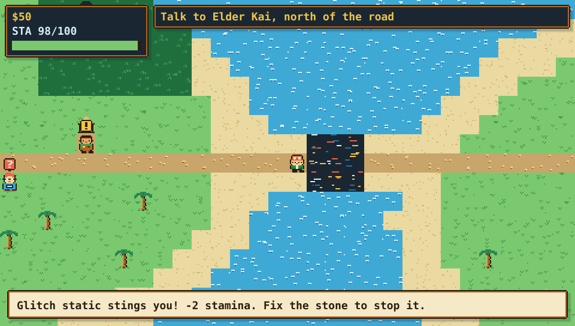
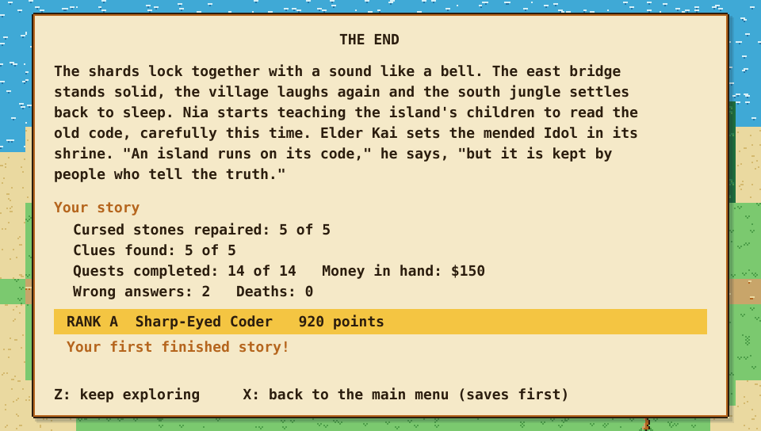
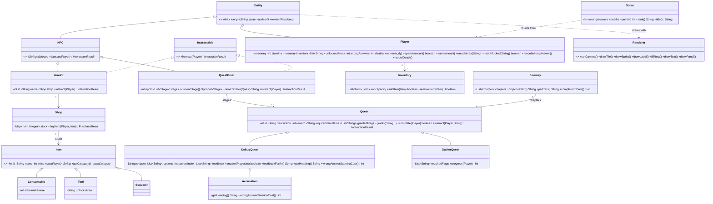
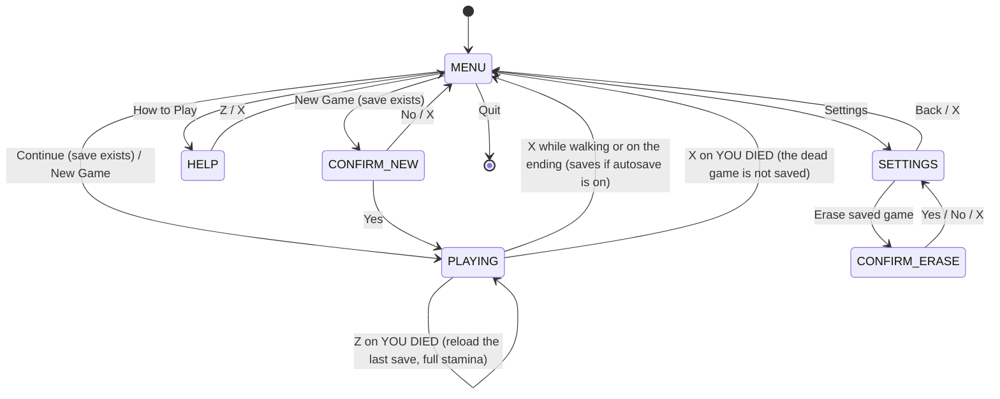
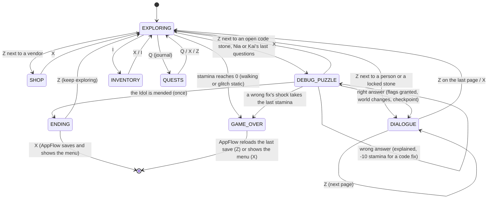
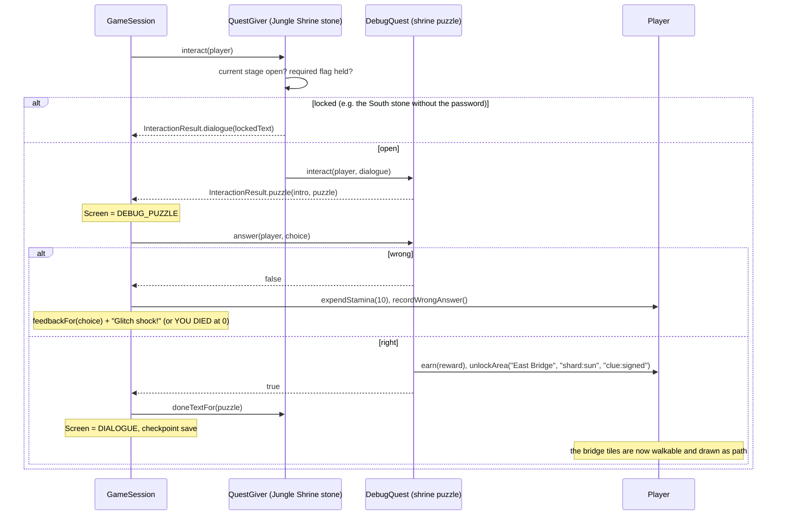
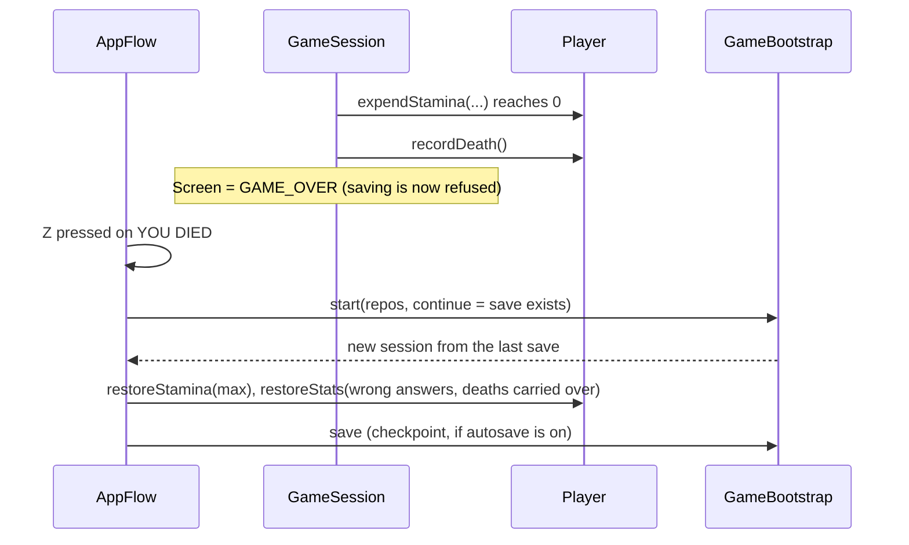
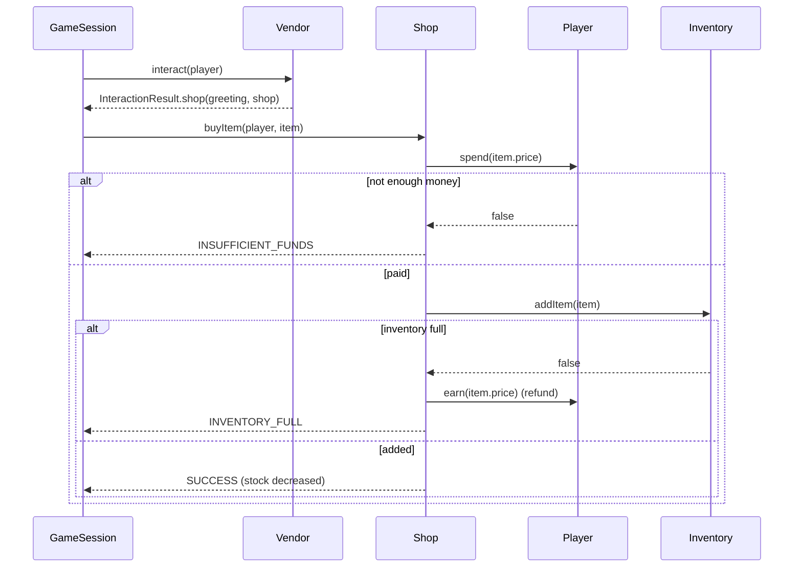

# Isla: The Broken Source

**A 2D top-down island mystery where you save the island by debugging its code.**
Java OOP course project, UIC College of Computing Education. Written in Java 21 with JavaFX, Maven, JDBC
(built-in H2 database or MySQL) and JUnit 5.

| Member | Role |
|---|---|
| Pearl Kristian M. Gardose | Coding, architectural design and debugging |
| Gian Theo M. Chiong | Manuscript and debugging |
| Kyle Andrei A. Arigo | Art style and testing |
| Drazen Jr. I. Nepa | Diagrams |

| Exploring | A cursed code stone | The journal |
|---|---|---|
|  |  |  |

| The glitched bridge stings | The looping village | The endless jungle |
|---|---|---|
|  |  |  |

| Who broke the Idol? | You died | The ending and your rank |
|---|---|---|
|  |  |  |

---

## Contents

1. [Run it](#1-run-it)
2. [The story](#2-the-story)
3. [How to play](#3-how-to-play)
4. [Scoring and ranks](#4-scoring-and-ranks)
5. [Architecture](#5-architecture)
6. [OOP concepts](#6-oop-concepts)
7. [Diagrams](#7-diagrams)
8. [Database](#8-database)
9. [Testing](#9-testing)
10. [Extending the game](#10-extending-the-game)
11. [Known limitations](#11-known-limitations)
12. [Project documents](#12-project-documents)

---

## 1. Run it

| You need | Version | Check with |
|---|---|---|
| JDK | 21 | `java -version` |
| Apache Maven | 3.9 or newer | `mvn -version` |
| Internet | first run only | Maven downloads JavaFX 21.0.5, H2 2.2.220, MySQL Connector/J 8.4.0 and JUnit 5.10.2 |

Open a terminal in the folder that contains `pom.xml`:

```bash
mvn javafx:run     # play
mvn test           # run the 381 unit tests
```

The game opens on the main menu. **No database server is needed**: progress is saved in a built-in H2 database in
an `isla-data/` folder that is created on first run. To skip the menu and start over:
`mvn javafx:run -Djavafx.args="--new"`. To build a runnable jar or a double-click app, see `docs/PACKAGING.md`.

**Optional MySQL.** Create a database (`CREATE DATABASE isla CHARACTER SET utf8mb4;`), copy `db.properties.example` to
`db.properties` and fill in the URL, user and password. The game creates its tables on first run
(`src/main/resources/db/schema.sql`). If MySQL is down the game says so and uses the built-in database; if neither
can open, it runs from memory and warns that progress will not be saved.

---

## 2. The story

Isla runs on code: the **Source**, carved into the island's Golden Idol. Three nights ago, during a storm, someone
cut the Idol into three shards (**Sun, Moon, Sea**) and the island began to glitch. The east bridge will not draw,
the village is stuck repeating "Lovely day!" forever, and the south jungle grows without end.

You fix the cursed **code stones**. Each one shows a real line of broken Java. Every fix changes the world, returns a
shard or a clue, and the clues point to whoever broke the Idol.

| Chapter | Where | What you do | What it opens |
|---|---|---|---|
| **1. The Missing Bridge** | Home island | Hear Elder Kai out ($20). Practise on Coder Nia's bug (+$40, optional). Buy Tomas's machete, cut into the jungle and fix the **Jungle Shrine** stone (a `for` loop that never runs) | The east bridge, the **Sun shard**, a clue: the code was signed "-N" |
| **2. The Looping Village** | East island | Fix the **village stone** (a `while` loop that never ends) | The villagers wake and the **Moon shard** drops. Fisher Lio saw a square of blue light; Pip points to Grandma Ula; Ula trades the south stone's password for a Seashell Necklace and remembers a machete chopping at midnight |
| **3. The Endless Jungle** | South shore, then the big south island | Unlock the **South Bridge** stone with Ula's word (`equals` vs `equalsIgnoreCase`). Buy a lantern from Ofa, light it and fix the **Overgrowth** stone (recursion with no base case). Fix the **temple altar** (integer division) | The south bridge, the cleared jungle, the **Sea shard**, a clue: two cracked round lenses |
| **Finale: The Truth** | Elder Kai | Bring the shards. Answer **Who broke the Idol?** from your clues (a wrong guess gets that suspect's alibi), then mend the Idol (one last bug) | The ending and your rank |

The suspects are Tomas, Yara, Coder Nia and Elder Kai. Each clue fits only one of them, and Nia, asked a second
time, admits she is wearing her *spare* glasses.

---

## 3. How to play

### Controls

| Key | Action |
|---|---|
| Arrows / WASD | Walk; move a menu or puzzle cursor |
| Z / Enter / Space | Talk (and turn the page of long dialogue), confirm, buy, use, submit an answer |
| X / Esc / Backspace | Cancel or close; while walking, leave to the main menu (saves first if autosave is on) |
| I | Inventory (Left/Right switches tabs, Z uses an item) |
| Q | Journal: chapter, goal, shards, clues, side goals, your rank so far |
| R | Rest next to a hut ($10, full stamina). Nothing happens in the open |
| F5 | Save |
| Z / X on the ending screen | Keep exploring / back to the main menu |
| Z / X on the YOU DIED screen | Wake up at your last save, fully rested / back to the main menu |

### Rules

- **Always know what to do next.** The gold strip at the top of the screen shows the next story step. The journal
  (Q) shows everything you have found.
- **Code stones** (dark tablets marked `?`) open a puzzle: a broken line of Java and four fixes. A **wrong fix explains
  why it is wrong and shocks you for 10 stamina**. The right fix changes the map at once: glitch tiles become path and
  red vines wither into grass.
- **Some stones and people are locked** until the story allows: the South Bridge stone needs the password, the
  Overgrowth stone needs a lit lantern, and the villagers loop until their stone is fixed. They tell you what they need.
- **Glitch hazards.** Every step taken next to a broken glitch tile (the east and south bridges, the red vines)
  stings for **2 extra stamina**. Fixing the stone ends it.
- **Stamina and death.** Walking costs 1 stamina per 4 steps. Food restores it (Coconut Water +20, Grilled Fish +40,
  Stamina Tonic +100 and more), and a nap next to a hut costs $10 and restores it fully. At **20 or less** the bar
  turns red and you feel faint. At **0 you die** from walking, from glitch static, or from a wrong fix's shock.
  **Z** wakes you at your last save with full stamina, so you can never die over and over. **X** returns to the menu,
  and the dead game is never saved.
- **Checkpoints.** With *Autosave* on (the default), the game saves by itself every time you finish a story step.
- **Money and shops.** You start with $50 and 6 inventory slots. Mara sells fruit; Tomas sells the Rusty Machete $30,
  the Seashell Necklace $15 and the Carved Tiki $25; Yara, in the jungle, sells the Stamina Tonic $25; Ofa, in the
  village, sells Grilled Fish $12, the Lantern $35 and a necklace. Stones and quests pay a little. A purchase is
  refused without enough money or with a full inventory, and you are never charged for nothing.
- **Items.** Consumables restore stamina. Tools open things: the machete opens the jungle and the lantern lets you
  read the dark stone. Souvenirs are keepsakes (Ula wants the necklace).
- **Nia's practice puzzle** is drawn from a bank of 13 every new game, never the one you had last time, with the
  answers shuffled. Continue keeps your puzzle.
- **Main menu:** Continue (greyed out without a save), New Game (asks before overwriting), How to Play, Settings
  (*Autosave* on/off, *Erase saved game*), Quit. It also shows your best rank.

A first playthrough takes about 20 to 30 minutes. The shortest route is a little over 300 steps.

---

## 4. Scoring and ranks

Every playthrough starts at **1000 points**: **-40** for each wrong answer (code fixes and accusations) and
**-150** for each death. The ending shows your rank and whether you beat your best, which is remembered on this
computer (in `settings.properties`) and shown on the main menu.

| Rank | Points | Title |
|---|---|---|
| **S** | 1000: no wrong answers, no deaths | Master Debugger |
| **A** | 850 or more | Sharp-Eyed Coder |
| **B** | 650 or more | Steady Fixer |
| **C** | 400 or more | Lucky Guesser |
| **D** | below 400 | Glitch Magnet |

Deaths and mistakes always count, including ones made after your last save: the counts are carried over when you
wake up, and written into the save even if you quit from the death screen.

---

## 5. Architecture

```
isla            the model: Entity, Player, NPC, Vendor, QuestGiver, Item (Consumable, Tool, Souvenir), Inventory,
                Shop, Quest, DebugQuest, GatherQuest, Accusation, Journey, Interactable, InteractionResult,
                Renderer (interface), Launcher (jar entry point)
isla.world      TileType (terrain, including the cursed glitch tiles), TileMap (loads maps/island.txt),
                GameWorld (movement, collision, huts and glitch hazards, who you can talk to)
isla.game       AppFlow (menu, help, settings, playing, death and ending), GameSession + Screen (keys -> game
                state -> drawing), GameBootstrap (start, save, erase), SeedData (all items, shops and story),
                DebugQuestBank (Nia's 13 practice puzzles), Score (points and ranks), Settings, AppPaths, TitleScene
isla.dao        Repository<T>; ItemDAO, PlayerDAO, VendorDAO, QuestDAO, each with an in-memory and a JDBC version;
                Database (MySQL or built-in H2), StorageOpener (chooses where to save)
isla.ui         JavaFX only: IslaApp, JavaFxRenderer, KeyBindings; pure-Java art helpers: Palette, Sprites,
                SpriteLibrary, TileKind, TileTexture, WalkAnimator, PixelImages, Bitmap
```

**Design idea.** Only `isla.ui` imports JavaFX. Everything else draws through the small `Renderer` interface and
receives input as plain `Action` values, so the whole game, from the menu to the ending, is unit-tested without
opening a window.

**Story as data.** All the story (dialogue, puzzles, rewards, clues) lives in `SeedData`. The database only
remembers what changed: which quests are done, stock left, flags, money and position. Story text can be rewritten
without touching game logic.

**Story flags.** Completing a quest can *grant* flags (`Quest.grants(...)`): an area ("East Bridge"), a shard
("shard:sun"), a clue ("clue:signed") or the password. A quest stage can *require* a flag before it opens. Glitch
tiles are walkable once their flag is set. Flags are saved with the player's unlocked areas.

**Look and feel.** Everything is drawn in code, with no image files: a 480x272 picture of 16x16 tiles, shown 2x
with crisp pixels. There is one 16-colour palette (`Palette`), hand-pixelled sprites for every character and the
code stones (`Sprites`), textured and animated tiles (water, flickering glitch bridges, pulsing red vines), and an
animated sunset title screen. Any sprite can be replaced by dropping a PNG into `src/main/resources/sprites/`
(see the README there).

---

## 6. OOP concepts

| Pillar | Where |
|---|---|
| **Encapsulation** | `Player.spend()` validates funds; the score counts only go up through `recordWrongAnswer()`/`recordDeath()` (or are restored from a save, never negative); `Inventory` and `Shop` keep their collections private and enforce capacity and stock; `Score` keeps the scoring rules in one immutable value; `Settings` hides how options are stored |
| **Inheritance** | `Player`/`NPC` extend `Entity`; `Vendor`/`QuestGiver` extend `NPC`; `DebugQuest` and `GatherQuest` extend `Quest`; `Accusation` extends `DebugQuest`; `Consumable`/`Tool`/`Souvenir` extend `Item` |
| **Polymorphism** | `Item.use()` differs per item type; `Interactable.interact()` returns a shop for a `Vendor` and dialogue or a puzzle for a `QuestGiver`; `Quest.interact()` turns in a fetch quest, `DebugQuest` overrides it to open a puzzle and `GatherQuest` to count the shards; `Accusation` overrides the puzzle heading and the cost of a wrong answer (no stamina shock); `Entity.render()` draws "!" for vendors and "?" for quest givers |
| **Abstraction** | `Entity`, `NPC` and `Item` are abstract; `Interactable`, `Renderer` and the DAO interfaces hide how things are drawn or stored |
| **Composition** | a `Journey` has the story's chapters, the very `Quest` objects the NPCs hand out, so finishing a quest moves the objective strip on by itself; a `Player` has an `Inventory`; a `Vendor` has a `Shop` |

---

## 7. Diagrams

### Class diagram



### State diagram: the app (menu)



### State diagram: screens while playing (GameSession)



### Sequence diagram: fixing a cursed code stone



### Sequence diagram: dying and waking up



### Sequence diagram: buying an item



---

## 8. Database

The same schema and SQL run on MySQL and on the built-in H2 database (H2 in `MODE=MySQL`). Every statement in
`schema.sql` is `CREATE TABLE IF NOT EXISTS`, so an older database gains new tables automatically.

| Table | Holds |
|---|---|
| `players` | name, money, stamina, position |
| `player_stats` | wrong answers and deaths for the score |
| `items` | the item catalog (type, price, stamina restored, area unlocked) |
| `inventory` | which items the player carries, and how many |
| `unlocked_areas` | areas and story flags: "Jungle Path", "East Bridge", "shard:sun", "clue:signed", ... |
| `vendors`, `shop_stock` | each vendor, and the stock left in each shop |
| `quests` | quest text, reward, required item, completed flag |
| `debug_quests`, `quest_options` | a puzzle's snippet and correct answer, and its options in order |

The DAO layer (`Repository<T>`: `save`, `findById`, `findAll`, `delete`) has an in-memory and a JDBC
implementation of each DAO. Both pass the same contract tests (`DaoContractTest`). Saving a player (row, inventory,
flags and stats) happens in one transaction.

**Quest ids:** 2 is Nia's random practice puzzle; 10 to 13 are Elder Kai's four chapters; 20 to 22 the villagers;
30 to 34 the code stones; 35 Nia's chat. Story quests are rebuilt from `SeedData` at every start and the table only
says which are done. A save from the game's earlier coconut story (no quest 10) cannot be continued: Continue is
greyed out and the next game starts fresh.

---

## 9. Testing

`mvn test` runs **381 JUnit 5 tests**. The database tests use a throwaway in-memory H2 database, so no setup is
needed. They cover:

- **the whole story, played by walking.** `BrokenSourceStoryTest` walks the island tile by tile with real key
  presses (pathfinding to each person), buys what it needs, fixes every stone, makes and checks a wrong accusation,
  names the culprit and reaches the ending. Further tests check every story gate, puzzle feedback, paging, the
  journal, and that the story survives save and continue;
- **hazards, death and scoring:** glitch static, death from walking, static and shocks, the faint warning, waking at
  the last save, never saving a dead game, stats carried across death, the rank rules and the remembered best score;
- the model rules: buying, inventory limits, stamina, quests, quest stages and flags;
- every screen and the menu flow, driven by plain `Action` inputs and a recording renderer instead of a window;
- the map: each island opens exactly when the story says, and with every stone fixed every walkable tile is reachable;
- the DAO layer (in-memory and JDBC against the same contract), persistence and the storage fallbacks;
- the art helpers: palette, sprites (every grid is 16x16 and uses palette letters), textures and animation.

To run the database tests on MySQL instead (they **empty** the tables of the database you name, so use a throwaway one):

```bash
mvn test -Disla.test.jdbcUrl=jdbc:mysql://localhost:3306/isla_test \
         -Disla.test.jdbcUser=isla -Disla.test.jdbcPassword=isla
```

Some tests deliberately break the setup, so fallback messages printed during a run are expected.

---

## 10. Extending the game

- **Story text and puzzles:** everything is in `SeedData`. A story puzzle is a `DebugQuest` with
  `withFeedback(...)` (one line per wrong answer) and `grants(...)` (the flags it opens), placed with `stone(...)`.
- **Practice puzzles:** add one entry to `DebugQuestBank` (a title, a broken line, the fix and three wrong answers).
- **People, vendors and items:** add them in `SeedData`. Give an NPC its own look by drawing a grid in `Sprites` and
  mapping its sprite key; an unknown key is drawn as a plain coral square so it is easy to spot.
- **The map** is `src/main/resources/maps/island.txt`, one character per tile: `g` grass, `s` sand, `w` water, `p` path,
  `t` palm, `h` hut (rest next to it), `j` jungle (needs the machete), and the cursed tiles `e` (east bridge),
  `v` (south bridge) and `o` (red vines). `tools/GenerateMap.java` rebuilds the plain world from the original island
  but does not know the cursed tiles, so put them back afterwards (the tests will tell you if you forget).
- **Scoring:** the numbers are constants in `Score`.

---

## 11. Known limitations

- One saved game per computer (or per database); there are no player profiles.
- The story is linear with one ending; your choices change your rank, not the outcome.
- The puzzles are multiple choice: you pick a fix, you don't type one.
- There is no sound or music, and the font is the default one.
- A save from the earlier coconut version of the game cannot be continued.
- `docs/PACKAGING.md` describes a runnable jar and a double-click app; these have not been tried on every operating system.

---

## 12. Project documents

- `docs/superpowers/specs/2026-10-04-isla-design.md`: the original approved design (milestones 1 to 5)
- `docs/superpowers/specs/2026-10-29-broken-source-design.md`: the story, hazards and scoring design
- `docs/superpowers/plans/2026-10-04-isla-milestones-1-3.md`: the first implementation plan
- `docs/BUILD_LOG.md`: what was built, the decisions made, and what was checked
- `docs/PRESENTATION_NOTES.md`: a demo route and who explains what
- `docs/PACKAGING.md`: building a runnable jar or app
- `src/main/resources/sprites/README.md`: replacing a code-drawn sprite with a PNG
