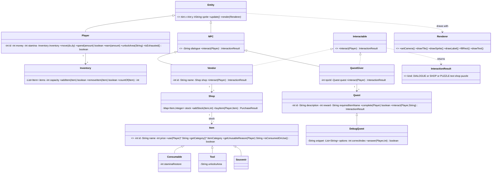
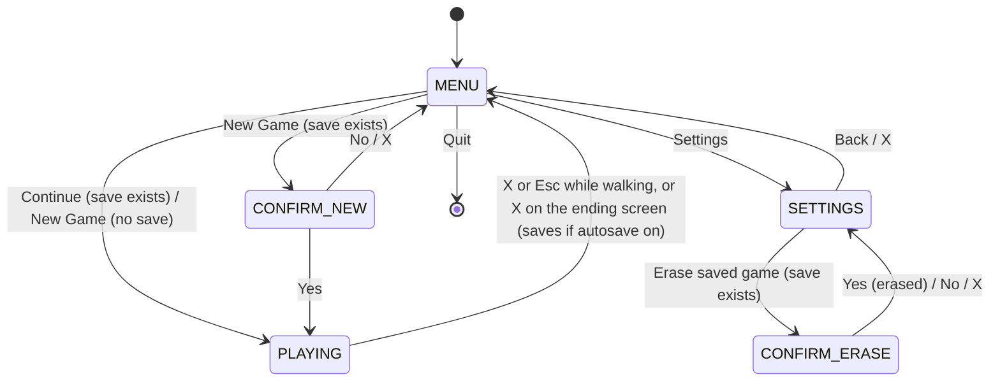
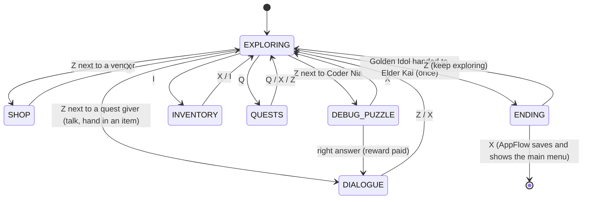
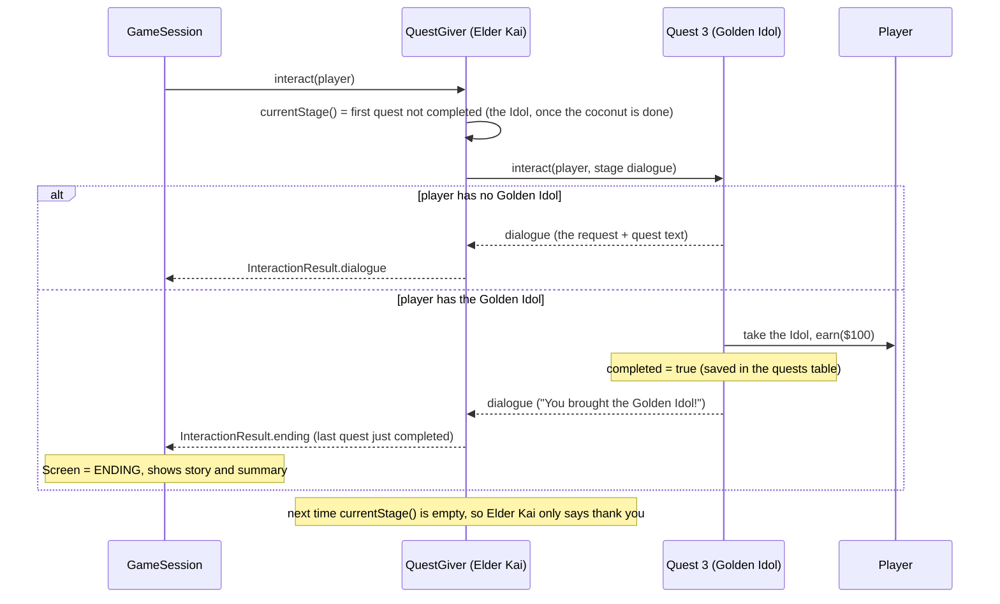
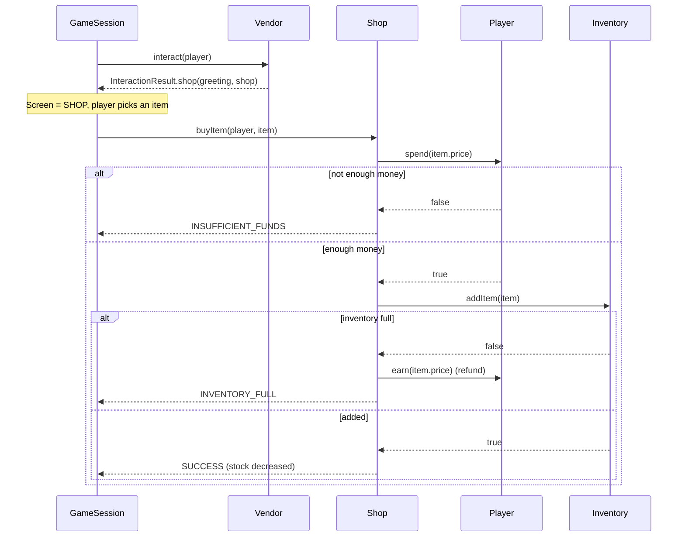

# Isla: A 2D Island Trading Adventure

Java OOP course project (UIC, College of Computing Education): a GBA-style top-down island game.
Walk around a tile-based island, buy items from vendors on a limited budget, manage a capacity-limited
inventory, and run a simple fetch quest. Progress is saved to MySQL.

**Author:** Pearl Kristian M. Gardose (Pj)

**Status:** milestones 1-4 done (walkable island, interaction/shop/inventory UI, MySQL persistence, `DebugQuest` puzzle)
plus the **main menu** from milestone 5 (Continue / New Game / Settings / Quit) and a **clear goal with an ending**
(Elder Kai's two quests, a quest list on Q, and an ending screen). Still open from milestone 5:
real art, the Figma prototype and the pitch deck.


## Run it

Requirements: JDK 21, Maven 3.9+. Nothing else: saving uses a built-in database (H2) that Maven downloads for you.
MySQL is optional.

```bash
mvn javafx:run          # play
mvn test                # unit tests (the database tests run on the built-in H2; MySQL is optional, see below)
```

The game opens on the main menu. Add `--new` to skip the menu and start over, discarding the saved game:
`mvn javafx:run -Djavafx.args="--new"`.

### Saving: works out of the box

Progress is saved with **F5**, automatically when you leave the island with X/Esc, and when the window closes
(unless you turn **Autosave on close** off in Settings). The game stores it in a **built-in database** in the
`isla-data/` folder next to `pom.xml` (created on first run, ignored by git). Delete that folder, or use
*Settings > Erase saved game*, to start from scratch.

The game picks where to save like this:

1. **MySQL**, if a `db.properties` file exists and the server answers (see below).
2. Otherwise the **built-in database**. If `db.properties` exists but MySQL is down, you get a notice and the built-in one is used.
3. Only if the built-in database cannot open either (read-only folder, or a second Isla window already has it open)
   does the game run from memory and show "No database available - progress will not be saved."

### Optional: use your own MySQL server

```sql
CREATE DATABASE isla CHARACTER SET utf8mb4;
```

Copy `db.properties.example` to `db.properties` (next to `pom.xml`) and fill in the URL, user and password.
The game creates the tables and seeds the island on first run (`src/main/resources/db/schema.sql`).
Saves already in the built-in database are not copied over to MySQL.

The DAO and save/continue tests run on a throwaway in-memory H2 database by default. To run them on MySQL instead
(they **empty** the tables in the database you name, so use a throwaway one):

```bash
mvn test -Disla.test.jdbcUrl=jdbc:mysql://localhost:3306/isla_test \
         -Disla.test.jdbcUser=isla -Disla.test.jdbcPassword=isla
```

## Controls

| Key | Action |
|---|---|
| Arrows / WASD | Walk, move cursor (Up/Down chooses a puzzle option) |
| Z / Enter / Space | Talk, confirm, buy, use, submit a puzzle answer |
| X / Esc / Backspace | Cancel, leave |
| I | Inventory (Left/Right switches tabs) |
| R | Rest (+10 stamina) |
| Q | Quest list (Q, X or Z closes it) |
| F5 | Save |
| X / Esc (while walking) | Leave the island back to the main menu (saves first if autosave is on) |
| Z / X (on the ending screen) | Z keeps exploring, X goes back to the main menu (saves first if autosave is on) |

## How the game works

- **Main menu:** *Continue* loads your save (greyed out when there is none), *New Game* starts over (and asks
  "Overwrite your saved game?" first, defaulting to No), *How to Play* (goal and controls), *Settings*, *Quit*.
- **Settings:** *Autosave on close* On/Off (remembered in `settings.properties`) and *Erase saved game* (asks first).

- Start with $50, 100 stamina, 6 inventory slots. Walking costs 1 stamina per 10 steps; at 0 you must rest (R) or use a consumable.
- Vendors (`!`) sell items with limited stock. Buying is blocked without enough money or with a full inventory (you are never charged for nothing).
- **The goal: help Elder Kai** (`?`, just north of where you start). He asks for two things, one after the other, and his
  dialogue follows the stage:
  1. a **Coconut** (sold by Mara for $8): pays $25 once;
  2. then a **Golden Idol** (sold by Yara in the jungle for $60): pays $100 once, and **the story ends**.
  Once both are delivered he only says thank you. Delivering the Idol before the coconut quest is done does nothing
  (he asks for the coconut first).
- **Money tip:** the Machete ($30) plus the Idol ($60) cost more than the $67 you have after the coconut. Do **Coder Nia's
  puzzle** (+$40) first: it is the way to afford the Idol.
- **Quest list (Q):** one line per quest giver, the main goal first. It shows the active goal, e.g. *Bring Elder Kai a coconut*,
  then *Find the Golden Idol in the jungle*, then *Done: Elder Kai has his Golden Idol*, and the side quest
  *Help Coder Nia fix her code* (*Done: ...* once solved).
- **Ending:** delivering the Idol opens the ending screen once: a short closing story and a summary (quests completed,
  money earned from quests, money in hand). **Z** keeps exploring (the game carries on normally), **X** saves and goes back
  to the main menu. After that, talking to Elder Kai never shows the ending again, and neither does Continue.
- **Coder Nia** (teal square, below the main road near the start) has a broken line of code. Pick the fix from four options. A wrong pick costs nothing and you can retry; the right one pays $40 once.
  Every **new game draws a different puzzle** from a bank of 13 (never the one you had last time) with the answers shuffled; **Continue keeps your puzzle**.
  Add your own in `DebugQuestBank.java` (one entry each).
- The world is now **80x52**: the home island, a village island to the east (follow the road across the bridge) and a big island to the south (the bridge at the bottom of the home island).
- The **Rusty Machete** (Tomas, $30) is a Tool: use it from the inventory to unlock the **Jungle Path**, which hides Yara's rare items.

## Architecture

```
isla            model: Entity, Player, NPC, Vendor, QuestGiver (one or more quest stages), Item (+3 subclasses), Inventory, Shop, Quest,
                       Interactable, InteractionResult, Renderer (interface)
isla.world      TileType, TileMap (loads maps/island.txt), GameWorld (movement, collision, interaction)
isla.game       AppFlow (menu / settings / playing), Settings, GameSession (Actions -> state -> drawing),
                GameBootstrap (start/save/erase), SeedData (starting content)
isla.dao        Repository<T> + ItemDAO/PlayerDAO/VendorDAO/QuestDAO, in-memory and JDBC implementations,
                Database (MySQL or built-in H2), StorageOpener (picks which one to use)
isla.ui         JavaFX only: IslaApp, JavaFxRenderer, KeyBindings
```

Only `isla.ui` imports JavaFX. Everything else draws through the small `Renderer` interface, so the whole game
is unit-tested without a window (276 tests).

### OOP pillars

- **Encapsulation:** `Player.spend()` validates funds; `Inventory` and `Shop` keep their collections private and enforce capacity/stock; `Player.getUnlockedAreas()` is read-only.
- **Inheritance:** `Player`/`NPC` extend `Entity`; `Vendor`/`QuestGiver` extend `NPC`; `DebugQuest` extends `Quest`; `Consumable`/`Tool`/`Souvenir` extend `Item`.
- **Polymorphism:** `Item.use()` and `Item.getUnusableReason()` differ per subclass; `Interactable.interact()` returns a shop for a `Vendor` and dialogue for a `QuestGiver`; `Quest.interact()` turns in a fetch quest, while `DebugQuest` overrides it to open a puzzle; `Entity.render()` draws a "!" for vendors and a "?" for quest givers.
- **Abstraction:** `Entity`, `NPC`, `Item` are abstract; `Interactable`, `Renderer` and the DAO interfaces hide how things are drawn or stored.

### Class diagram



### State diagram: app flow (main menu)



### State diagram: screens while playing (GameSession)

The `PLAYING` state above is itself a small state machine: `Screen` decides how each key is read and what is drawn.
Z, X and Q below are the actions Confirm, Cancel and Quests.



### Sequence diagram: delivering the Golden Idol (the ending)



### Sequence diagram: player buys an item



## Database

The same schema and DAOs run on MySQL or on the built-in H2 database (H2 in `MODE=MySQL`), so there is one
set of SQL for both. 
`players`, `items`, `inventory`, `vendors`, `shop_stock`, `quests` as in the original plan, plus a few additions
the game needs (see `docs/BUILD_LOG.md`): table `unlocked_areas`, and columns `items.unlocks_area`,
`quests.required_item`, `vendors.sprite`, `vendors.dialogue`. The quests table holds three rows: 1 (Elder Kai's coconut),
2 (Nia's puzzle) and 3 (Elder Kai's Golden Idol). Row 3 is an ordinary `Quest`, so **there is no schema change**; it is
seeded like Nia's puzzle, so a save from before it existed gains it on Continue. Milestone 4 adds `debug_quests` (snippet, correct answer) and `quest_options` (the choices, in order), kept in their own tables so a database created earlier gains them automatically. The DAO layer (`Repository<T>`: `save`,
`findById`, `findAll`, `delete`) has an in-memory and a JDBC implementation; both pass the same contract
tests (`DaoContractTest`).

## Editing the island

`src/main/resources/maps/island.txt` is plain text, one character per tile (80x52 now):
`g` grass, `s` sand, `w` water (blocked), `p` path, `t` palm (blocked), `h` hut (blocked),
`j` jungle (needs the Jungle Path). Tests check that every tile you can walk on can be reached from the start
(and that only Yara's jungle pocket needs the machete), so an accidental cut-off island fails the build.

To regenerate or enlarge the world, edit and run `java tools/GenerateMap.java` (it grows `tools/island-40x26.txt`, the
original island, keeping every original coordinate). Add NPCs in `SeedData` on tiles the generator leaves as grass or path.

## Project docs

- `docs/PACKAGING.md`: how to build one runnable jar or a double-click app so anyone can play

- `docs/superpowers/specs/2026-10-04-isla-design.md`: approved design
- `docs/superpowers/plans/2026-10-04-isla-milestones-1-3.md`: implementation plan
- `docs/BUILD_LOG.md`: what was built, decisions, verification, limitations
