# Isla: A 2D Island Trading Adventure

Java OOP course project (UIC, College of Computing College): a GBA-style top-down island game.
Walk around a tile-based island, buy items from vendors on a limited budget, manage a capacity-limited
inventory, help the islanders with quests and debug broken code to earn money. Progress is saved to a built-in
database (no setup), or to MySQL if you prefer.

## Team

| Member | Role                                             |
|---|--------------------------------------------------|
| Pearl Kristian M. Gardose | Coding, Architectural Design and Whole Debugging |
| Gian Theo M. Chiong | Manuscript and debugging                         |
| Kyle Andrei A. Arigo | Art style and testing                            |
| Drazen Jr. I. Nepa | Diagrams                                         |

**Status:** milestones 1-4 done plus milestone 5's main menu and art pass, and a full story campaign,
**The Broken Source** (see *The story* below): three chapters across all three islands, five cursed code stones,
clues, a culprit to unmask and an ending. Still open from milestone 5: the Figma prototype and the pitch deck.

| Exploring (with the objective strip) | Story dialogue | Debug puzzle (a wrong fix explains itself) |
|---|---|---|
| 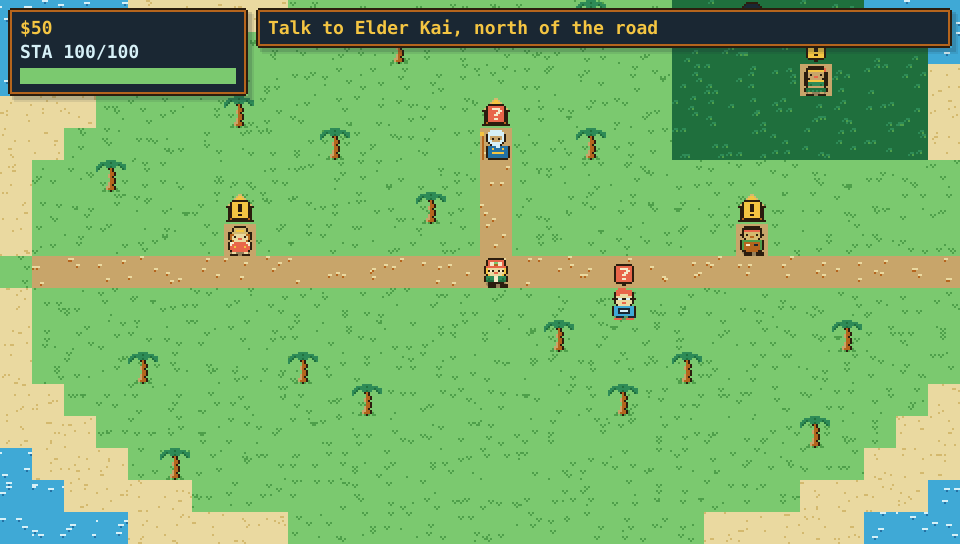 | 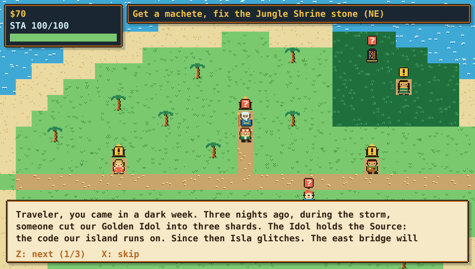 | 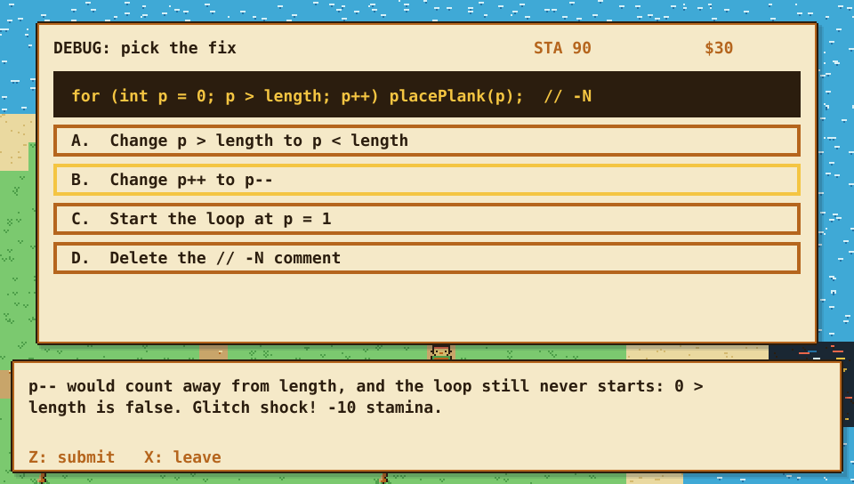 |

| The glitched east bridge | The looping village | The endless jungle |
|---|---|---|
| 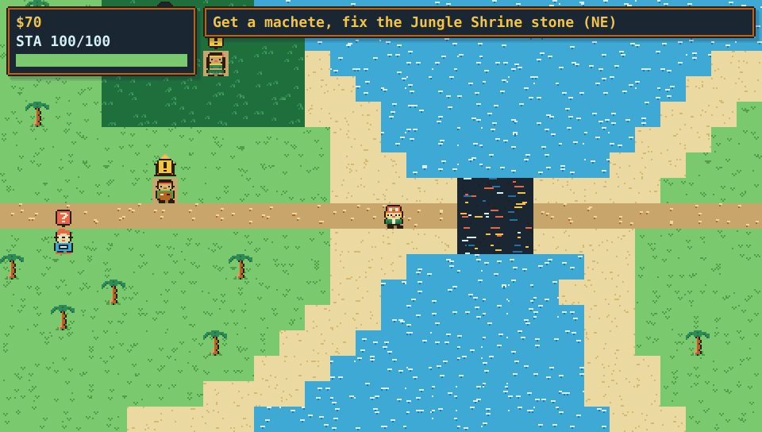 | 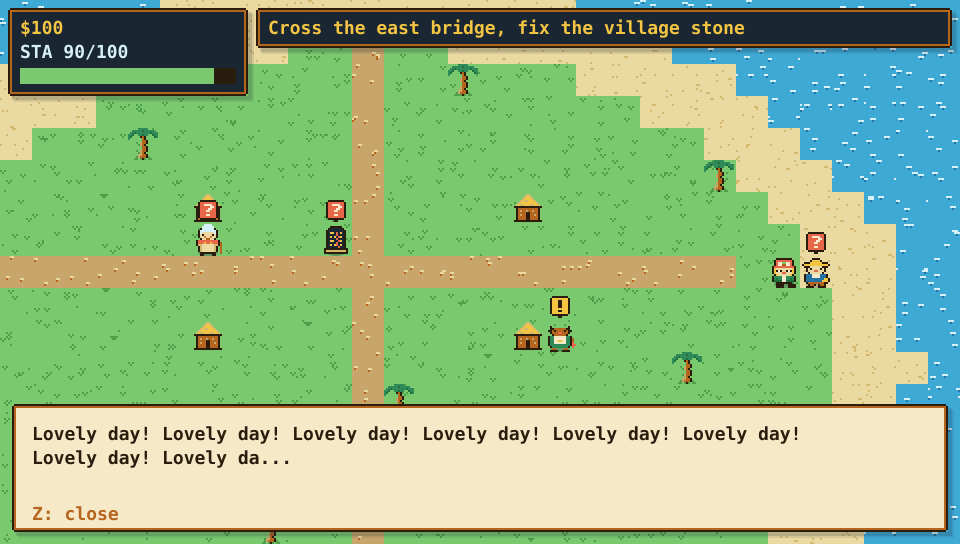 | 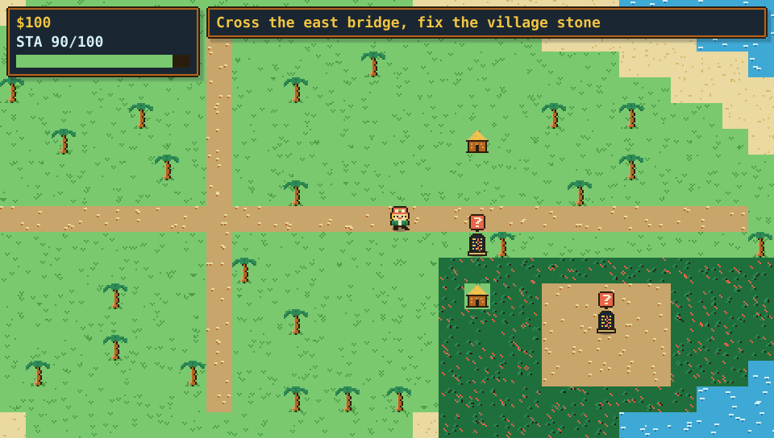 |

| Journal (Q) | Who broke the Idol? | Main menu |
|---|---|---|
| 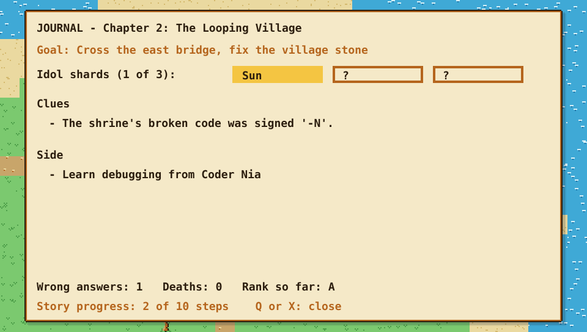 | 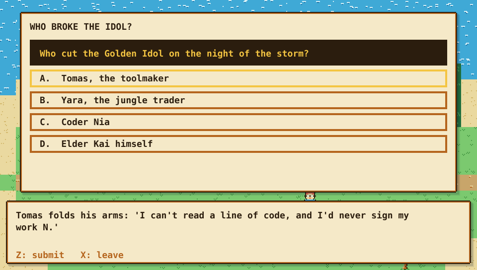 | 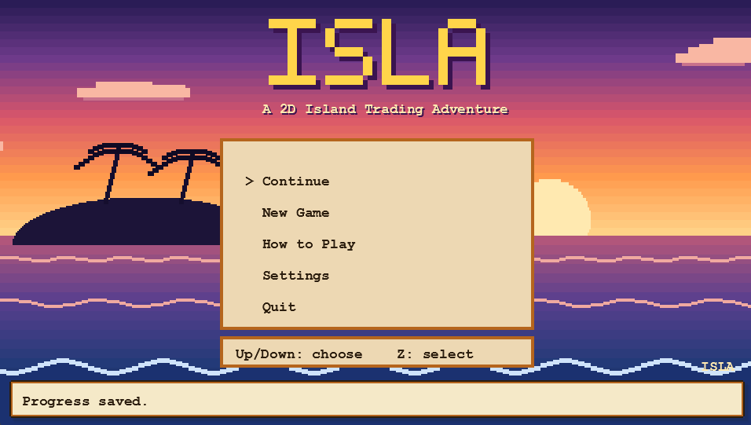 |

| You died (stamina hit 0) |
|---|
| 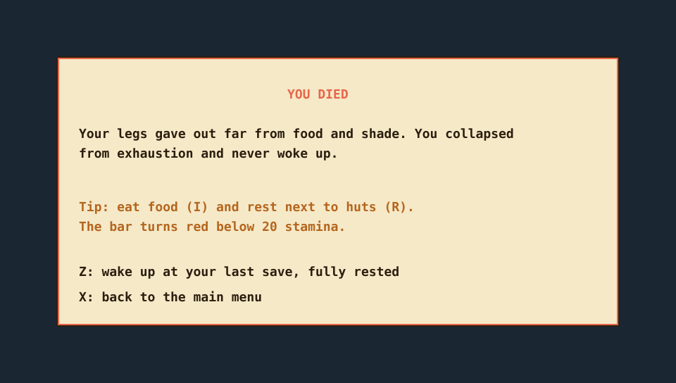 |

## Run it

| You need | Version | Notes |
|---|---|---|
| **JDK** | 21 | Check with `java -version` |
| **Apache Maven** | 3.9 or newer | Check with `mvn -version` |
| Internet (first run only) | | Maven downloads the libraries: JavaFX 21.0.5, H2 2.2.220 (built-in save database), MySQL Connector/J 8.4.0 (only used if you pick MySQL) and JUnit 5.10.2 (tests) |

No database server is required: saving works out of the box. MySQL is optional.

Clone the repository (or unzip it), open a terminal in the folder that contains `pom.xml`, then:

```bash
mvn javafx:run          # play
mvn test                # unit tests (the database tests run on the built-in H2; MySQL is optional, see below)
```

The game opens on the main menu. Add `--new` to skip the menu and start over, discarding the saved game:
`mvn javafx:run -Djavafx.args="--new"`.

### Saving: works out of the box

Progress is saved with **F5**, automatically when you leave the island with X/Esc, and when the window closes
(unless you turn **Autosave on close** off in Settings). The game stores it in a **built-in database** in the
`isla-data/` folder next to `pom.xml` (created on first run, ignored by git). Delete that folder, or use
*Settings > Erase saved game*, to start from scratch. Files stay in the project folder when you run from it; launched
from anywhere else (for example a packaged app) they go in a `.isla` folder in your home directory.

The game picks where to save like this:

1. **MySQL**, if a `db.properties` file exists and the server answers (see below).
2. Otherwise the **built-in database**. If `db.properties` exists but MySQL is down, you get a notice and the built-in one is used.
3. Only if the built-in database cannot open either (read-only folder, or a second Isla window already has it open)
   does the game run from memory and show "No database available - progress will not be saved."

### Optional: use your own MySQL server

```sql
CREATE DATABASE isla CHARACTER SET utf8mb4;
```

Copy `db.properties.example` to `db.properties` (next to `pom.xml`) and fill in the URL, user and password.
The game creates the tables and seeds the island on first run (`src/main/resources/db/schema.sql`).
Saves already in the built-in database are not copied over to MySQL.

The DAO and save/continue tests run on a throwaway in-memory H2 database by default. To run them on MySQL instead
(they **empty** the tables in the database you name, so use a throwaway one):

```bash
mvn test -Disla.test.jdbcUrl=jdbc:mysql://localhost:3306/isla_test \
         -Disla.test.jdbcUser=isla -Disla.test.jdbcPassword=isla
```

## Controls

| Key | Action |
|---|---|
| Arrows / WASD | Walk, move cursor (Up/Down chooses a puzzle option) |
| Z / Enter / Space | Talk (and turn the page of long dialogue), confirm, buy, use, submit a puzzle answer |
| X / Esc / Backspace | Cancel, leave |
| I | Inventory (Left/Right switches tabs) |
| R | Rest next to a hut: $10 for full stamina. Nothing happens in the open, and at 0 stamina you die |
| Q | Journal: chapter, goal, shards, clues and side goals (Q, X or Z closes it) |
| F5 | Save |
| X / Esc (while walking) | Leave the island back to the main menu (saves first if autosave is on) |
| Z / X (on the ending screen) | Z keeps exploring, X goes back to the main menu (saves first if autosave is on) |
| Z / X (on the YOU DIED screen) | Z wakes you at your last save, fully rested; X goes to the main menu without saving |

## The story: The Broken Source

Isla runs on code: the **Source**, carved into the island's Golden Idol. Three nights ago, during a storm, someone cut
the Idol into three shards (**Sun, Moon, Sea**) and the island began to glitch. The east bridge will not draw, the
village is stuck in a loop saying "Lovely day!" forever, and the south jungle grows without end. You fix the cursed
**code stones** (each one is a real Java bug), which opens the way and turns up the shards and clues. Then you name
the culprit and mend the Idol.

| Chapter | Where | What you do | What it opens |
|---|---|---|---|
| 1. The Missing Bridge | Home island | Hear Elder Kai out ($20). Learn on Nia's practice bug (+$40, optional). Buy the machete from Tomas, cut into the jungle, fix the **Jungle Shrine** stone (a loop that never runs) | The east bridge, the **Sun shard**, clue: the code is signed "-N" |
| 2. The Looping Village | East island | Fix the **village stone** (`while` loop that never ends) | The villagers wake up, the **Moon shard**. Fisher Lio remembers a square of blue light; Pip points to Grandma Ula; Ula trades the south stone's password for a Seashell Necklace and remembers a machete chopping at midnight |
| 3. The Endless Jungle | Home south shore, then the big south island | Unlock the **South Bridge** stone with Ula's word (`equals` vs `equalsIgnoreCase`). Buy a lantern from Ofa, light it, fix the **Overgrowth** stone (recursion with no base case). Fix the **temple altar** (integer division) | The south bridge, the cleared jungle, the **Sea shard**, clue: two cracked round lenses |
| Finale: The Truth | Elder Kai | Bring the three shards. Answer **Who broke the Idol?** from your clues (a wrong guess gets the suspect's alibi). Mend the Idol (one last bug) | The ending |

The suspects are Tomas, Yara, Nia and Kai himself. Every clue fits only one of them (and Nia, asked a second time,
mentions she's wearing her *spare* glasses).

## How the game works

- **Main menu:** *Continue* loads your save (greyed out when there is none), *New Game* starts over (and asks
  "Overwrite your saved game?" first, defaulting to No), *How to Play* (goal and controls), *Settings*, *Quit*.
- **Settings:** *Autosave on close* On/Off (remembered in `settings.properties`) and *Erase saved game* (asks first).
- **Always know what to do next:** the gold **objective strip** at the top of the screen shows the next story step,
  and the **journal (Q)** shows the chapter, the goal, which shards you have, every clue you've found and side goals.
- **Cursed stones** (dark tablets with a `?`) open a debug puzzle: a broken line of Java and four fixes. A **wrong fix
  explains why it's wrong and shocks you for 10 stamina**, so guessing has a cost. The right fix changes the world:
  glitched bridge tiles turn into path and cursed jungle withers into grass, right there on the map.
- **Some stones and people are locked** until the story says so: the South Bridge stone needs the password, the
  Overgrowth stone needs a lit lantern, the villagers loop until their stone is fixed. They tell you what they need.
- **Stamina, and dying:** walking costs 1 stamina per 4 steps (the whole story is over 300 steps on the shortest
  route) and a wrong code fix costs 10. Food restores it, and **R** next to a hut buys a nap for **$10** (full stamina); there is no
  resting in the open, so pressing R does nothing out there. At **20 or less** the bar turns red and you're warned that you feel faint. At **0 you die**:
  the *YOU DIED* screen offers **Z** (wake up at your last save, fully rested, so you can never die in a loop) or
  **X** (main menu; the dead game is never saved).
- **Checkpoints:** with *Autosave* on, the game also saves by itself every time you finish a story step (fixing a
  stone, a villager's quest, Kai's chapters), so dying never costs much. F5 still saves at any time.
- **Money and shops:** start with $50 and 6 slots. **Mara** (fruit), **Tomas** (Rusty Machete $30, Seashell Necklace $15,
  Carved Tiki $25), **Yara** in the jungle (Stamina Tonic $25, Carved Tiki) and **Ofa** in the village (Grilled Fish $12,
  Lantern $35, Seashell Necklace). Stones and quests pay a little. Buying is blocked without enough money or with a full
  inventory (you are never charged for nothing).
- **Items:** **Consumables** restore stamina, **Tools** open things (the machete opens the jungle, the lantern lets you read
  the dark stone), **Souvenirs** are keepsakes (Ula wants a Seashell Necklace).
- **Long dialogue is paged:** Z turns the page, X skips.
- **Nia's practice puzzle** is drawn from a bank of 13 each new game (never the one you had last time), with the answers
  shuffled; Continue keeps your puzzle. The story stones are fixed puzzles written for the story.
- **Ending:** mending the Idol opens the ending screen once: the closing story and a summary (stones repaired, clues
  found, quests done, money). **Z** keeps exploring, **X** saves and goes back to the main menu.

## Look and feel

Everything on screen is drawn in code, so the game needs no image files. The game draws a **480x272** picture made of
**16x16-pixel** tiles (30x17 visible) and the window shows it enlarged 2x with no smoothing, so the pixels stay crisp.

- **Palette:** one warm tropical set of 16 colours (`Palette`). Sprites are written as 16x16 grids with one letter per colour, so
  changing a colour in `Palette` recolours the whole game.
- **Characters:** hand-pixelled sprites in `Sprites`, each with an outline and its own look: the player (red cap with a tree badge,
  blonde hair, shades, green jacket), Mara (straw hat, coral apron), Tomas (headband, wooden work apron), Yara (gold headband with a
  feather, leaf clothes), Elder Kai (white hair and beard, blue robe, golden staff) and Coder Nia (coral bun, round glasses, laptop).
  Each has a soft shadow under its feet.
- **Walking:** the player has two frames and bobs while walking, then stands still (`WalkAnimator`).
- **Tiles:** grass, sand, water, path and jungle get a texture picked from the tile's position (`TileTexture`), so the ground
  looks varied but never flickers when the camera moves. Water animates between two frames. Palms and huts are sprites drawn over grass.
- **Markers:** a gold `!` bubble over shops and a coral `?` bubble over people who need help; they bob up and down slightly.
- **Panels:** the shop, inventory, dialogue, puzzle, quest list, ending, menus and the HUD all use one pixel-art panel
  (`Renderer.drawPanel`): a soft drop shadow, a dark outline with notched corners and a ring in the border colour.
  The font is the default one; no font file is bundled.
- **Main menu:** an animated sunset scene (`TitleScene`): a gradient sky, a half-set sun, drifting clouds, a palm-island silhouette,
  rolling waves and a pixel-letter ISLA logo.
- **Your own art:** drop a PNG named after a sprite (`player.png`, `mara.png`, `tomas.png`, `yara.png`, `elder_kai.png`,
  `coder_nia.png`, `palm.png`, `hut.png`, `exclaim.png`, `question.png`) into `src/main/resources/sprites/` to replace the
  code-drawn version. It must be 16 pixels tall and 16 x N wide for N frames side by side (`player.png` at 32x16 gives the
  two walking frames). A missing, unreadable or wrong-sized file is ignored and the code-drawn sprite shows instead. PNGs are
  read the first time a sprite is drawn, so restart the game after changing one. See the README in that folder.
- **How it is drawn:** the game logic only sends tile colours, sprite keys and rectangles to the `Renderer`. `JavaFxRenderer`
  turns the sprite and tile grids into images once, enlarges them to the window scale and keeps them in a cache, so the canvas
  draws them one-to-one. The animation clock is a frame counter that `IslaApp` hands to the renderer with `setFrame`; the
  game itself ignores it. The renderer recognises a tile's terrain from its colour (`TileKind`), and a test fails if a
  `TileType` colour ever has no texture.

## Architecture

```
isla            model: Entity, Player, NPC, Vendor, QuestGiver (quest stages, optionally locked until a story flag),
                       Item (+3 subclasses), Inventory, Shop, Quest (can grant story flags), DebugQuest (per-answer feedback),
                       GatherQuest (needs several flags: the shards), Accusation (who did it?), Journey (the story's
                       chapters), Interactable, InteractionResult, Renderer (interface), Launcher (jar entry point)
isla.world      TileType, TileMap (loads maps/island.txt), GameWorld (movement, collision, interaction)
isla.game       AppFlow (menu / how to play / settings / playing), Settings, AppPaths, TitleScene (animated menu backdrop),
                GameSession + Screen (Actions -> state -> drawing), GameBootstrap (start/save/erase),
                DebugQuestBank (Nia's 13 practice puzzles), SeedData (the items, shops and the whole story)
isla.dao        Repository<T> + ItemDAO/PlayerDAO/VendorDAO/QuestDAO, in-memory and JDBC implementations,
                Database (MySQL or built-in H2), StorageOpener (picks which one to use)
isla.ui         JavaFX only: IslaApp, JavaFxRenderer, KeyBindings.
                Pure-Java art helpers (tested without a window): Palette, Sprites, SpriteLibrary, TileKind, TileTexture,
                WalkAnimator, PixelImages, Bitmap
```

Only `isla.ui` imports JavaFX. Everything else draws through the small `Renderer` interface, so the whole game
is unit-tested without a window (344 tests). Besides the six drawing methods, `Renderer` has two optional (default) ones:
`setFrame(int)`, which the game ignores, and `drawPanel(...)`, which by default is just two rectangles; only `JavaFxRenderer`
gives them the animated and pixel-art look.

### OOP pillars

- **Encapsulation:** `Player.spend()` validates funds; `Inventory` and `Shop` keep their collections private and enforce capacity/stock; `Player.getUnlockedAreas()` is read-only.
- **Inheritance:** `Player`/`NPC` extend `Entity`; `Vendor`/`QuestGiver` extend `NPC`; `DebugQuest` and `GatherQuest` extend `Quest`; `Accusation` extends `DebugQuest`; `Consumable`/`Tool`/`Souvenir` extend `Item`.
- **Polymorphism:** `Item.use()` and `Item.getUnusableReason()` differ per subclass; `Interactable.interact()` returns a shop for a `Vendor` and dialogue for a `QuestGiver`; `Quest.interact()` turns in a fetch quest, `DebugQuest` overrides it to open a puzzle and `GatherQuest` to count the shards; `Accusation` overrides the puzzle heading and the cost of a wrong answer; `Entity.render()` draws a "!" for vendors and a "?" for quest givers.
- **Composition:** a `Journey` has the story's chapters (the same `Quest` objects the NPCs hand out), so finishing a quest moves the objective strip on by itself.
- **Abstraction:** `Entity`, `NPC`, `Item` are abstract; `Interactable`, `Renderer` and the DAO interfaces hide how things are drawn or stored.

### Class diagram

```mermaid
classDiagram
  class Entity { <<abstract>> #int x #int y #String sprite +update() +render(Renderer)* }
  class Player { -int id -int money -int stamina -Inventory inventory +move(dx,dy) +spend(amount) boolean +earn(amount) +unlockArea(String) +isExhausted() boolean }
  class NPC { <<abstract>> -String dialogue +interact(Player)* InteractionResult }
  class Vendor { -int id -String name -Shop shop +interact(Player) InteractionResult }
  class QuestGiver { -int npcId -List~Stage~ stages +currentStage() Optional~Stage~ +doneTextFor(Quest) String +interact(Player) InteractionResult }
  class Interactable { <<interface>> +interact(Player) InteractionResult }
  class Item { <<abstract>> -int id -String name -int price +use(Player)* String +getCategory()* ItemCategory +getUnusableReason(Player) String +isConsumedOnUse() boolean }
  class Consumable { -int staminaRestore }
  class Tool { -String unlocksArea }
  class Souvenir
  class Inventory { -List~Item~ items -int capacity +addItem(Item) boolean +removeItem(Item) boolean +countOf(Item) int }
  class Shop { -Map~Item,Integer~ stock +addStock(Item,int) +buyItem(Player,Item) PurchaseResult }
  class Quest { -int id -String description -int reward -String requiredItemName -List~String~ grantedFlags +grants(String...) +complete(Player) boolean +interact(Player,String) InteractionResult }
  class DebugQuest { -String snippet -List~String~ options -int correctIndex -List~String~ feedback +answer(Player,int) boolean +feedbackFor(int) String +getHeading() String +wrongAnswerStaminaCost() int }
  class GatherQuest { -List~String~ requiredFlags +progress(Player) int +isCompletable(Player) boolean }
  class Accusation { +getHeading() String +wrongAnswerStaminaCost() int }
  class Journey { -List~Chapter~ chapters +objectiveText() String +partText() String +completedCount() int }
  class InteractionResult { <<value>> kind: DIALOGUE or SHOP or PUZZLE or ENDING text shop puzzle }
  class Renderer { <<interface>> +setCamera() +drawTile() +drawSprite() +drawLabel() +fillRect() +drawText() +setFrame() +drawPanel() }
  Entity <|-- Player
  Entity <|-- NPC
  NPC <|-- Vendor
  NPC <|-- QuestGiver
  Interactable <|.. Vendor
  Interactable <|.. QuestGiver
  Item <|-- Consumable
  Item <|-- Tool
  Item <|-- Souvenir
  Player "1" --> "1" Inventory
  Vendor "1" --> "1" Shop
  Shop "1" --> "*" Item : stock
  QuestGiver "1" --> "1..*" Quest : stages
  Quest <|-- DebugQuest
  Quest <|-- GatherQuest
  DebugQuest <|-- Accusation
  Journey "1" --> "*" Quest : chapters
  Entity ..> Renderer : draws with
  Interactable ..> InteractionResult : returns
```

### State diagram: app flow (main menu)

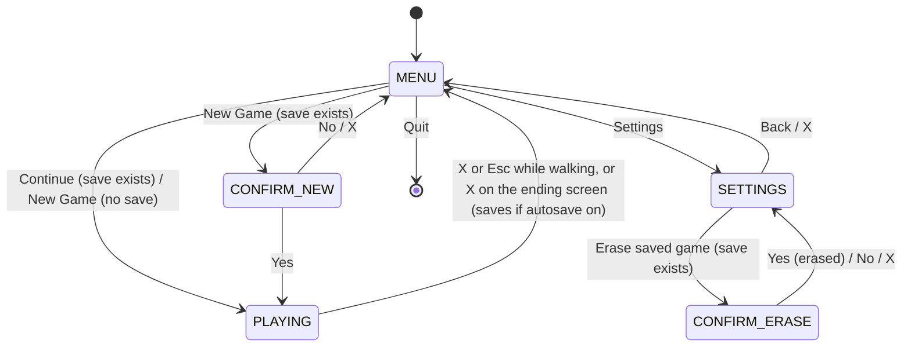

### State diagram: screens while playing (GameSession)

The `PLAYING` state above is itself a small state machine: `Screen` decides how each key is read and what is drawn.
Z, X and Q below are the actions Confirm, Cancel and Quests.

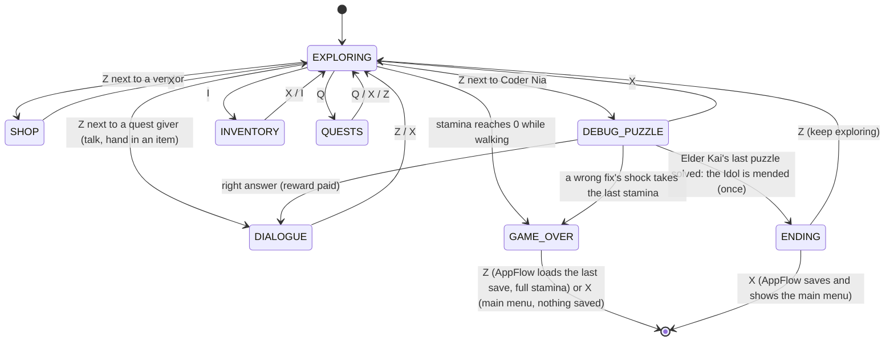

### Sequence diagram: fixing a cursed code stone

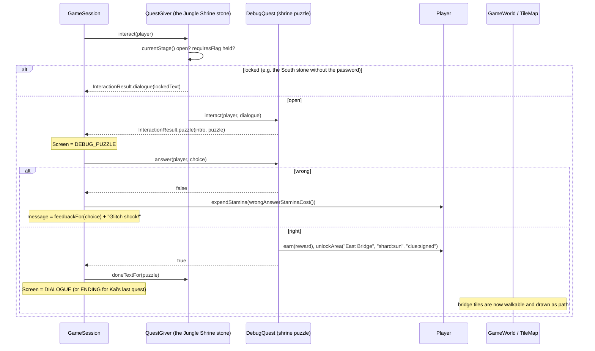

### Sequence diagram: player buys an item

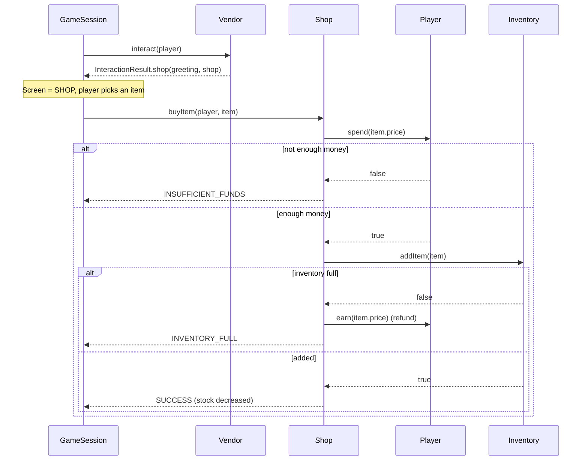

## Database

The same schema and DAOs run on MySQL or on the built-in H2 database (H2 in `MODE=MySQL`), so there is one
set of SQL for both.
**Story progress needs no new tables.** Story quests are rebuilt from `SeedData` every start and the `quests` table
only says which are done. Everything the story unlocks (bridges, shards, clues, the password) is a **story flag** in
`unlocked_areas`, next to the machete's "Jungle Path". Story quest ids: 10-13 Elder Kai, 20-22 the villagers,
30-34 the code stones, 35 Nia's chat; Nia's random practice puzzle is still quest 2. A save from the old coconut story
(no quest 10) cannot be continued: Continue is greyed out and the next game starts fresh.

`players`, `items`, `inventory`, `vendors`, `shop_stock`, `quests` as in the original plan, plus a few additions
the game needs (see `docs/BUILD_LOG.md`): table `unlocked_areas`, and columns `items.unlocks_area`,
`quests.required_item`, `vendors.sprite`, `vendors.dialogue`. Milestone 4 adds `debug_quests` (snippet, correct answer) and `quest_options` (the choices, in order), kept in their own tables so a database created earlier gains them automatically. The DAO layer (`Repository<T>`: `save`,
`findById`, `findAll`, `delete`) has an in-memory and a JDBC implementation; both pass the same contract
tests (`DaoContractTest`).

### Tables

| Table | Holds |
|---|---|
| `players` | money, stamina, position, name |
| `items` | the item catalog (type, price, stamina restored, area unlocked) |
| `inventory` | which items the player carries and how many |
| `vendors`, `shop_stock` | each vendor, and the stock left in each shop |
| `quests` | quest text, reward, required item, completed flag |
| `unlocked_areas` | areas the player has opened (e.g. the Jungle Path) |
| `debug_quests`, `quest_options` | a debugging puzzle's snippet and correct answer, and its answer choices in order |

## Testing

`mvn test` runs **364 JUnit 5 tests**. They cover:

- the model rules (buying, inventory limits, stamina, quests, the story chain and ending, the puzzle's right and wrong answers);
- every game screen and the menu flow through plain `Action` inputs, using a recording renderer instead of a window;
- the art helpers: palette, sprites (every grid is 16x16 and uses only palette letters, and the characters differ from each other),
  tile textures (the same tile always gets the same texture, water animates and land does not), the PNG-or-code-drawn choice,
  pixel scaling, walk animation, the default `Renderer` methods, and the title scene;
- the DAO layer: one shared contract test runs against both the in-memory and the JDBC implementations;
- persistence: save and continue, a puzzle surviving a restart, reopening the built-in database from its files;
- **the whole story, played by walking**: `BrokenSourceStoryTest` walks the island tile by tile with real key presses
  (pathfinding to each person), buys what it needs, fixes every stone, names the culprit and reaches the ending;
  plus every story gate, wrong-fix costs, paging, the journal, and that the story survives save and continue;
- the map: each island opens exactly when the story says (the glitched bridges and the vines), and with every stone
  fixed every walkable tile can be reached;
- the choice of storage and its fallbacks (MySQL down, folder not writable).

Some tests deliberately break the setup, so fallback messages printed during a run are expected.

## Editing the island

`src/main/resources/maps/island.txt` is plain text, one character per tile (80x52 now):
`g` grass, `s` sand, `w` water (blocked), `p` path, `t` palm (blocked), `h` hut (blocked, you can rest next to one),
`j` jungle (needs the Jungle Path), and the cursed tiles: `e` the east bridge glitch (opens with "East Bridge"),
`v` the south bridge glitch ("South Bridge") and `o` the overgrowth around the temple ("Overgrowth Cleared").
Tests check that each island opens exactly when the story says, so an accidental cut-off fails the build.

`tools/GenerateMap.java` builds the plain 80x52 world from the original island; it does **not** know the cursed
tiles, so after regenerating, put the `e`, `v` and `o` tiles back (the tests will tell you if you forget).

## Extending the game

- **Puzzles:** add one entry to `DebugQuestBank` (a title, a broken line of code, the fix and three wrong answers) for
  Nia's practice pool. A story puzzle is a `DebugQuest` in `SeedData` with `withFeedback(...)` (one line per wrong
  answer) and `grants(...)` (the flags it opens), handed out by a stone made with `SeedData.stone(...)`.
- **NPCs, vendors and items:** add them in `SeedData`. Give a new NPC its own look by drawing a grid in `Sprites` and mapping its
  sprite key in `Sprites.nameForKey`; an unknown key is drawn as a plain coral square so it is easy to spot.
- **Art:** edit a sprite grid in `isla.ui.Sprites` (colours come from `Palette`), or drop a PNG into
  `src/main/resources/sprites/` (see *Look and feel*); no other code change is needed.

## Known limitations

- One saved game per computer (or per database); there is no player-name or profile screen.
- A save from the old coconut story cannot be continued (the story changed completely); it is replaced on the next game.
- A built-in or MySQL database created before Mara and Tomas got separate sprite keys still stores `vendor_sprite` for both,
  so on that save both vendors look like Mara. Starting a *New Game* (or *Settings > Erase saved game*) reseeds them with their own sprites.
- `docs/PACKAGING.md` describes building a runnable jar and a double-click app; those steps have not been tried on every operating system.

## Project docs

- `docs/PACKAGING.md`: how to build one runnable jar or a double-click app so anyone can play
- `docs/superpowers/specs/2026-10-04-isla-design.md`: approved design
- `docs/superpowers/plans/2026-10-04-isla-milestones-1-3.md`: implementation plan
- `docs/BUILD_LOG.md`: what was built, decisions, verification, limitations
- `src/main/resources/sprites/README.md`: how to replace a code-drawn sprite with a PNG
