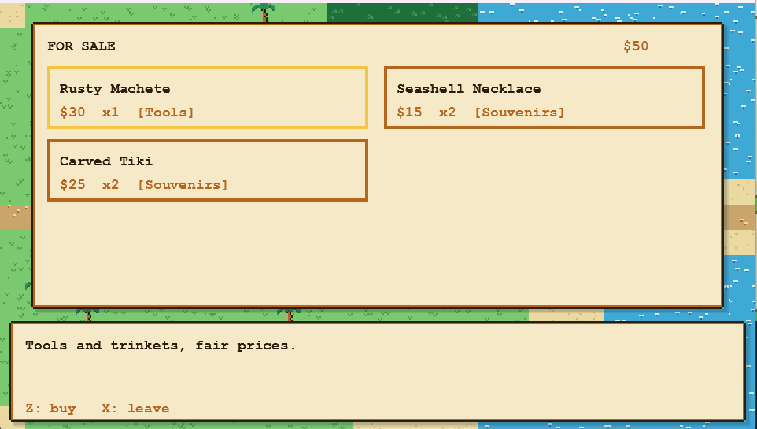
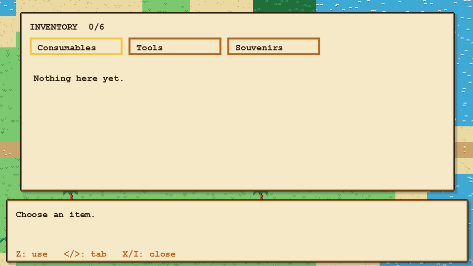
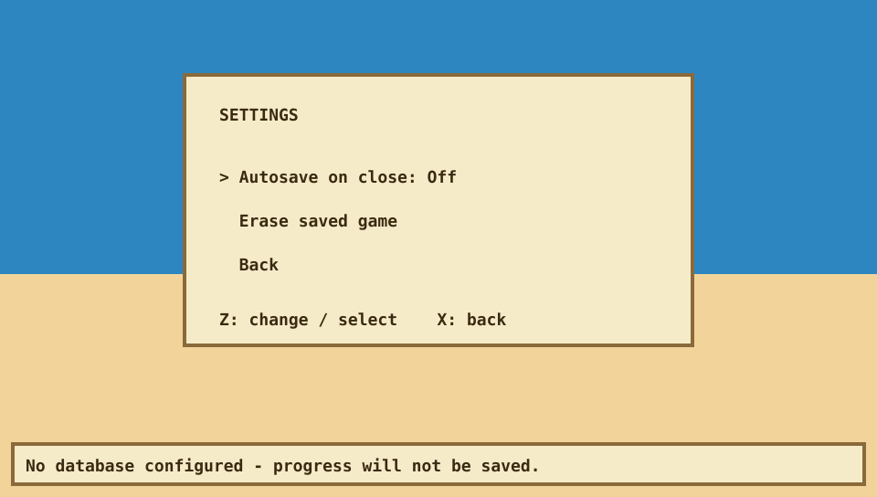
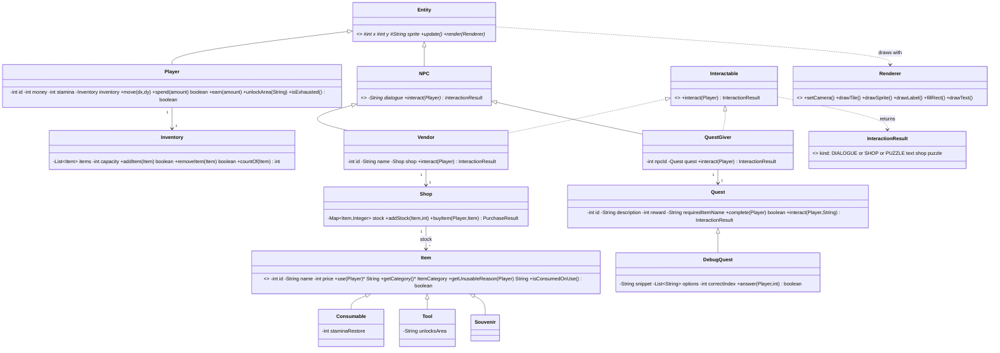
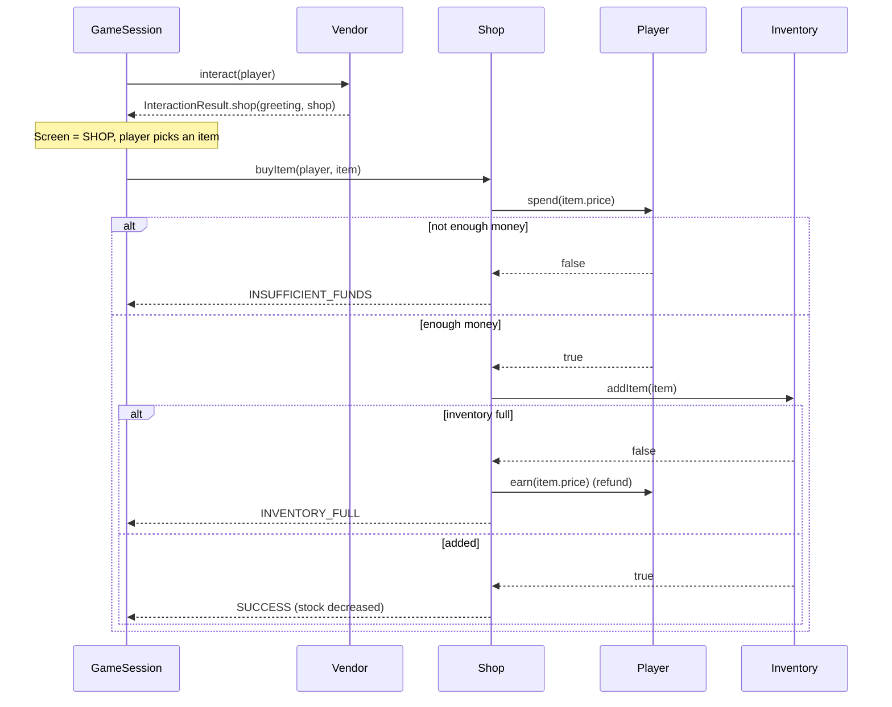
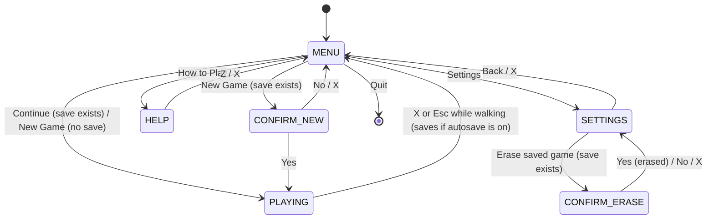

# Isla: A 2D Island Trading Adventure

A GBA-style, top-down island game written in **Java 21 with JavaFX**, built as a Java OOP course project
(UIC, College of Computing Education). Walk around a tile-based world, buy items from
vendors on a limited budget, manage a capacity-limited inventory, help the islanders with quests and
debug broken code to earn money. Progress is saved to a database.

## Team members and roles

| Member | Role |
|---|---|
| Pearl Kristian M. Gardose | Coding and debugging |
| Gian Theo M. Chiong | Coding and debugging |
| Kyle Andrei A. Arigo | Art style and testing |
| Drazen Jr. I. Nepa | Diagrams, pitch deck, demo script and video |

## Screenshots

| Exploring | Shop | Debug puzzle |
|---|---|---|
|  |  |  |

| Main menu | Inventory | Settings |
|---|---|---|
|  |  |  |

## What the game does

- **Explore** an 80x52 tile world made of three islands joined by bridges, with collision, a scrolling camera and a locked jungle.
- **Trade:** three vendors sell items with limited stock. You start with $50 and 6 inventory slots, and you are never charged for a purchase that fails.
- **Manage stamina:** walking costs 1 stamina per 10 steps. At 0 you cannot walk until you rest or use a consumable.
- **Quests:** a fetch quest (bring Elder Kai a coconut) and a **debugging puzzle** (Coder Nia shows a broken line of Java and you pick the fix).
- **A different puzzle each game:** a new game draws one of 13 puzzles (never the one you had last time) with the answers shuffled. Continuing keeps your puzzle.
- **Save and continue:** a main menu with Continue, New Game, How to Play, Settings and Quit. Saving works with no setup.

## Prerequisites and dependencies

| You need | Version | Notes |
|---|---|---|
| **JDK** | 21 | Check with `java -version` |
| **Apache Maven** | 3.9 or newer | Check with `mvn -version` |
| Internet (first run only) | | Maven downloads the libraries below |

Libraries (downloaded automatically by Maven, nothing to install by hand): JavaFX 21.0.5 (graphics), H2 2.2.220 (the built-in save database),
MySQL Connector/J 8.4.0 (only used if you choose MySQL) and JUnit 5.10.2 (tests only).
**No database server is required**: saving works out of the box. MySQL is optional (see below).

## Setup and installation

1. Clone this repository (or download it as a ZIP and unzip it), then open a terminal in the project folder (the one containing `pom.xml`).
2. That is all: the first `mvn` command below downloads everything the project needs.

## Running the game

```bash
mvn javafx:run
```

The game opens on the main menu. Choose **New Game** to start (see *Controls* below).
To skip the menu and start over, discarding any saved game: `mvn javafx:run -Djavafx.args="--new"`.

## Running the tests

```bash
mvn test
```

### Controls

| Key | Action |
|---|---|
| Arrows / WASD | Walk, move the menu cursor (Up/Down also chooses a puzzle answer) |
| Z / Enter / Space | Talk, confirm, buy, use, submit a puzzle answer |
| X / Esc / Backspace | Cancel, close a window, or (while walking) go back to the main menu |
| I | Inventory (Left/Right switches tabs) |
| R | Rest (+10 stamina) |
| F5 | Save |

### The world and its rules

| Who / what | Details |
|---|---|
| Mara (`!`) | Sells Coconut Water ($10), Coconut ($8) and Banana ($5) |
| Tomas (`!`) | Sells the Rusty Machete ($30), Seashell Necklace ($15) and Carved Tiki ($25) |
| Yara (`!`) | Hides in the jungle and sells rare items (Golden Idol $60). Reach her by using the machete to unlock the Jungle Path |
| Elder Kai (`?`) | Wants a Coconut and pays $25, once |
| Coder Nia (`?`) | Shows broken code. A wrong pick costs nothing and you can retry. The right fix pays $40, once |
| Items | **Consumables** restore stamina (and are kept if your stamina is already full), **Tools** unlock areas, **Souvenirs** are collectibles |

## Saving and the database

Progress is saved with **F5**, automatically when you leave the island with X/Esc, and when the window closes
(unless you switch **Autosave on close** off in Settings). *Settings > Erase saved game* starts from scratch.

The game chooses where to save, trying the best option first:

1. **MySQL**, if a `db.properties` file exists and the server answers (optional, see below).
2. Otherwise a **built-in H2 database** stored in an `isla-data/` folder. This is what normally happens, with no setup.
3. Only if neither can open does it run from memory and warn "progress will not be saved".

Files are kept in the project folder when you run from it. Launched from anywhere else (for example a packaged app),
they go in a `.isla` folder in your home directory.

**Using your own MySQL (optional):** create a database (`CREATE DATABASE isla CHARACTER SET utf8mb4;`), copy
`db.properties.example` to `db.properties` and fill in the URL, user and password. The game creates the tables and
seeds the island on first run (`src/main/resources/db/schema.sql`). The same schema and SQL run on both MySQL and H2
(H2 in `MODE=MySQL`).

### Tables

| Table | Holds |
|---|---|
| `players` | money, stamina, position, name |
| `items` | the item catalog (type, price, stamina restored, area unlocked) |
| `inventory` | which items the player carries and how many |
| `vendors`, `shop_stock` | each vendor, and the stock left in each shop |
| `quests` | quest text, reward, required item, completed flag |
| `unlocked_areas` | areas the player has opened (e.g. the Jungle Path) |
| `debug_quests`, `quest_options` | a debugging puzzle's snippet and correct answer, and its answer choices in order |

## Architecture

```
isla            model: Entity, Player, NPC, Vendor, QuestGiver, Item (+3 subclasses), Inventory, Shop,
                       Quest, DebugQuest, Interactable, InteractionResult, Renderer (interface)
isla.world      TileType, TileMap (loads maps/island.txt), GameWorld (movement, collision, interaction)
isla.game       AppFlow (menu / how to play / settings / playing), Settings, AppPaths, GameSession
                (keys -> game state -> drawing), GameBootstrap (start/save/erase), DebugQuestBank, SeedData
isla.dao        Repository<T>, ItemDAO / PlayerDAO / VendorDAO / QuestDAO with in-memory and JDBC versions,
                Database (MySQL or built-in H2), StorageOpener (chooses where to save)
isla.ui         the only package that imports JavaFX: IslaApp, JavaFxRenderer, KeyBindings
```

**Design idea:** only `isla.ui` touches JavaFX. Everything else draws through the small `Renderer` interface and
receives input as plain `Action` values, so the whole game, including the menu and the puzzle screens, is unit tested without opening a window.

### OOP concepts

| Pillar | Where it is used |
|---|---|
| **Encapsulation** | `Player.spend()` validates funds; `Inventory` and `Shop` keep their collections private and enforce capacity and stock; `Player.getUnlockedAreas()` is read-only; `Settings` hides how options are stored |
| **Inheritance** | `Player` and `NPC` extend `Entity`; `Vendor` and `QuestGiver` extend `NPC`; `Consumable`, `Tool` and `Souvenir` extend `Item`; `DebugQuest` extends `Quest` |
| **Polymorphism** | `Item.use()` and `getUnusableReason()` differ per item type; `Interactable.interact()` returns a shop for a `Vendor` and dialogue for a `QuestGiver`; `Quest.interact()` turns in a fetch quest while `DebugQuest` overrides it to open a puzzle; `Entity.render()` draws "!" for vendors and "?" for quest givers |
| **Abstraction** | `Entity`, `NPC` and `Item` are abstract; `Interactable`, `Renderer` and the DAO interfaces hide how things are drawn or stored |

### Class diagram



### Sequence diagram: the player buys an item



### State diagram: the menu and app flow



## Testing

The project has **244 JUnit 5 tests** (`mvn test`), written test-first. They cover:

- the model rules (buying, inventory limits, stamina, quests, the puzzle's right and wrong answers);
- every game screen and the menu flow through plain `Action` inputs, using a recording renderer instead of a window;
- the DAO layer: one shared contract test runs against both the in-memory and the JDBC implementations;
- persistence: save and continue, a puzzle surviving a restart, and reopening the built-in database from its files;
- the map: it is at least 80x52 and every tile you can walk on can be reached from the start;
- the choice of storage and its fallbacks (MySQL down, folder not writable).

The database tests run on a throwaway in-memory H2 database by default. To run them against MySQL instead
(they **empty** the tables of the database you name, so use a throwaway one):

```bash
mvn test -Disla.test.jdbcUrl=jdbc:mysql://localhost:3306/isla_test \
         -Disla.test.jdbcUser=isla -Disla.test.jdbcPassword=isla
```

Some of the tests deliberately break the setup, so the game's fallback messages are printed only when they genuinely happen.

## Extending the game

- **Map:** `src/main/resources/maps/island.txt` is plain text, one character per tile: `g` grass, `s` sand, `w` water (blocked),
  `p` path, `t` palm (blocked), `h` hut (blocked), `j` jungle (needs the Jungle Path). `java tools/GenerateMap.java` regenerates the
  80x52 world from the original island in `tools/island-40x26.txt`.
- **Puzzles:** add one entry to `DebugQuestBank` (a title, a broken line of code under about 60 characters, the fix and three wrong answers).
- **NPCs, vendors and items:** add them in `SeedData`.

## Known limitations

- The graphics are placeholder coloured squares and tiles; there is no final art yet.
- One saved game per computer (or per database); there is no player-name or profile screen.
- The two new islands have roads, huts and palms but no shops or NPCs yet.
- `docs/PACKAGING.md` describes building a runnable jar and a double-click app; those steps have not been tried on every operating system.

## Project documents

- `docs/BUILD_LOG.md`: what was built in each milestone, the decisions made, and what was checked.
- `docs/superpowers/specs/2026-10-04-isla-design.md`: the approved design.
- `docs/superpowers/plans/2026-10-04-isla-milestones-1-3.md`: the implementation plan.
- `docs/PACKAGING.md`: how to package the game for other people.
